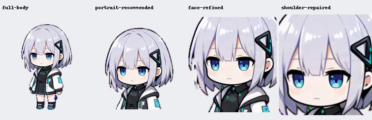
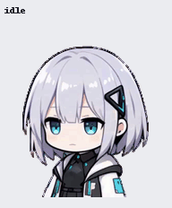
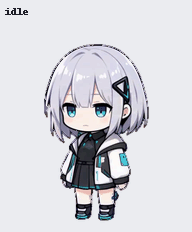
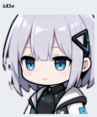
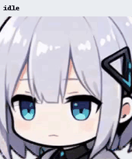

# 짚쨩 · GP-Chan Pets v2

GP-Chan을 바탕으로 제작한 **비공식 팬 가공 에셋 네 종류**입니다. 커뮤니티 GPT 모에화 밈 맥락의 작업이며 OpenAI나 원작자의 공식 배포물이 아닙니다.

**처음 사용하신다면 최초 상반신 버전 `portrait-recommended.png`를 추천합니다.** 후속 얼굴 확대본으로 대체하지 않고 최초 완성 상반신을 별도로 보존했습니다.

## 다운로드

[v1.0.0 릴리스](https://github.com/byongshintv/gpchan-pets/releases/tag/v1.0.0)에서 PNG를 개별 다운로드하거나 `gpchan-pets-v1.0.0.zip` 전체 묶음을 받으세요.

- [추천: 최초 상반신](https://github.com/byongshintv/gpchan-pets/releases/download/v1.0.0/portrait-recommended.png) — 얼굴과 상체를 함께 보여주는 첫 포트레이트.
- [전신](https://github.com/byongshintv/gpchan-pets/releases/download/v1.0.0/full-body.png) — 마지막 몸 윤곽 고정 보정본.
- [중간 얼굴 확대](https://github.com/byongshintv/gpchan-pets/releases/download/v1.0.0/face-refined.png) — 외곽 보정과 대기 프레임 선택을 마친 검증 후보.
- [최종 얼굴~어깨선](https://github.com/byongshintv/gpchan-pets/releases/download/v1.0.0/shoulder-repaired.png) — 승인된 근접 구도를 유지하며 동작을 보완한 버전.

## 적용 안내

각 `assets/*.png`는 **Pets v2 스프라이트 시트**입니다. PNG 전체를 그대로 사용하세요. 미리보기 GIF나 잘라낸 정지 이미지는 설치용 파일이 아닙니다.

1. 원하는 PNG를 다운로드합니다. 권장 파일은 `portrait-recommended.png`입니다.
2. Pets v2 등록을 지원하는 ChatGPT 환경에서 PNG를 첨부하고 “이 PNG를 Pets v2 커스텀 펫으로 등록해 주세요”라고 요청합니다. 해당 환경에 등록 기능이 제공되어야 합니다.
3. 등록 결과와 미리보기를 확인한 뒤 원하는 펫을 선택하세요. 이 저장소 다운로드만으로 계정의 펫이 변경되지는 않습니다.

설치 딥링크나 자동 설치기는 제공하지 않습니다. 원본 GP-Chan의 Python 데스크톱 앱과는 다른 스프라이트 형식입니다.

공통 사양: RGBA PNG 1536×2288, 192×208 셀, 8열×11행. 행별 사용 프레임 수는 `6, 8, 8, 4, 5, 8, 6, 6, 6, 8, 8`이며, 표준 9동작 57셀과 16방향 시선 16셀로 구성됩니다.

## 동작 미리보기

모든 GIF는 배포 PNG의 정확한 셀에서 추출했습니다. 표준 동작 다음에 16시선이 이어집니다. 표시 속도는 미리보기용이며 앱의 실제 재생 속도와 다를 수 있습니다. GIF 색상은 공통 팔레트로 양자화됩니다.

### 추천: 최초 상반신

### 전신

### 중간 얼굴 확대

### 최종 얼굴~어깨선

## 검증 상태와 한계

네 파일은 제작 당시의 최종 검증 기록과 SHA256이 일치합니다. 이번 배포에서도 크기·RGBA 형식·73개 사용 셀·15개 투명 빈 셀을 재확인했습니다. 과거 검수 기록을 새로운 실시간 앱 재생 검증으로 표현하지 않습니다.

- **전신:** Pets 구조·atlas/chroma·품질 검사 통과. 16시선의 하단 몸 영역(y≥125)은 RGBA가 동일합니다. 일부 중간각의 유사성과 방향군 경계의 큰 머리 이동은 남아 있습니다.
- **최초 상반신:** Pets 구조·atlas/chroma·품질 검사 통과. 시선 하단(y≥165)이 고정되어 있습니다. 의도적인 상반신 프레이밍으로 하반신, 내린 팔 일부와 소품 아래쪽은 화면 밖입니다. 중간각 구분 및 방향 전환 경고가 남아 있습니다.
- **중간 얼굴 확대:** 최종 `face-refined.png`의 Pets 구조·atlas/chroma·품질 검사 통과. 잘림이 있던 초기 크롭은 포함하지 않았습니다. 5개 중간각의 유사성, 머리끝과 어깨 사이 실제 빈 공간에 대한 연속성 경고가 남아 있습니다. 32px에서는 세밀한 손동작 구분이 약합니다.
- **최종 얼굴~어깨선:** Pets 구조·프레임·chroma·품질 검사 통과. **기본 atlas 밀도 검사는 실패**합니다. 얼굴이 셀 대부분을 채우는 승인 구도를 위해 문서화된 `--allow-near-opaque-used-cells` 옵션으로 밀도 항목을 경고 처리한 검사만 통과했습니다. 투명 배경·빈 셀·chroma 검사는 유지했습니다. 일부 중간각 유사성과 머리끝/어깨 사이 빈 공간 경고가 남아 있습니다.

연속 3D 회전이나 Live2D Cubism 모델이 아닙니다. 표준 9동작은 MiniMax 영상 프레임을 추출했고, 시선은 ImageGen 머리 방향 원화와 고정 몸을 합성했습니다. 크롭·경계 매팅·재샘플링·시트 조립을 거쳤습니다. 네 에셋 자체는 이번 배포에서 재생성하거나 수정하지 않았습니다. 젤리 테스트와 실패한 중간 시안은 제외했습니다.

## 출처와 권리 조건

원본: [gpgpchan-svg/GP-Chan](https://github.com/gpgpchan-svg/GP-Chan), 제작 기준 리비전 [548c25068ac0363311ce14debc8d8cd28892b69a](https://github.com/gpgpchan-svg/GP-Chan/tree/548c25068ac0363311ce14debc8d8cd28892b69a).

이 저장소는 원본을 바탕으로 한 **비공식 MiniMax / ImageGen 가공본**입니다. 원화·캐릭터 권리를 보유한다고 주장하지 않습니다. 원본의 별도 재배포 라이선스는 확인되지 않았으며, 2026-10-02 확인 시 GitHub 라이선스 메타데이터도 미지정 상태였습니다.

공개 다운로드가 자유 이용·상업 이용·재배포 허가를 의미하지 않습니다. MIT 등 오픈소스 라이선스를 에셋에 임의 부여하지 않습니다. 이용·재배포 전 원본 권리자와 관련 생성 서비스의 적용 조건을 별도로 확인해 주세요. 자세한 경계는 [출처 및 조건](SOURCE_AND_TERMS.md)에 정리했습니다.

## 무결성 확인

[SHA256SUMS](SHA256SUMS)는 에셋·미리보기·문서의 체크섬입니다. 내려받은 전체 묶음에서 `sha256sum -c SHA256SUMS`로 확인할 수 있습니다. 릴리스의 `RELEASE-SHA256SUMS.txt`에는 ZIP 및 개별 PNG의 체크섬이 있습니다.
